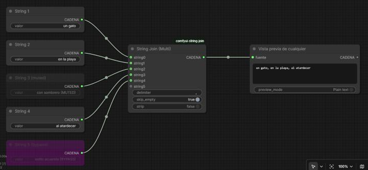

# ComfyUI String Join (Multi)

A ComfyUI custom node that joins **any number of strings** into a single string using a configurable delimiter.



*Five sources connected: `String 3` is muted and `String 5` is bypassed, so they are simply left out → `un gato, en la playa, al atardecer`.*

## Features

- **Auto-growing input** – connect `string0` and a new `string1` socket appears, and so on (up to 100).
- **Lists supported** – any socket also accepts a list of strings; every item is joined.
- **Custom delimiter** – escape sequences `\n`, `\t`, `\r` and `\\` are understood (e.g. `\n` joins one per line).
- **Muted / bypassed sources are ignored** – if an upstream node is muted or bypassed, its string just doesn't count; the node keeps working. If *all* sources are gone, the output is an empty string.
- `skip_empty` – drop empty (or whitespace-only) strings so you never get `a, , b`.
- `strip` – trim leading/trailing whitespace from each string before joining.
- **Reset inputs button** – disconnects all string inputs and restores `delimiter`, `skip_empty` and `strip` to their defaults.

## Inputs / output

| Name | Type | Default | Description |
|---|---|---|---|
| `delimiter` | STRING | `, ` | Separator placed between strings. Supports `\n`, `\t`, `\r`, `\\`. |
| `skip_empty` | BOOLEAN | `true` | Skip empty or whitespace-only strings. |
| `strip` | BOOLEAN | `false` | Trim each string before joining. |
| `string0 … string99` | STRING (optional) | – | Strings or lists of strings, joined in socket order. |
| **output** `STRING` | STRING | – | The joined string. |

> **Bypass note:** ComfyUI's bypass passes a node's *input* through to its output when the types match. A bypassed node with no STRING input (like a primitive string) is dropped and doesn't count; a bypassed node that *has* a STRING input forwards that input instead.

## Installation

Requires a recent ComfyUI with the V3 node API (dynamic "Autogrow" inputs) – tested on ComfyUI **0.41.0**.

```bash
cd ComfyUI/custom_nodes
git clone https://github.com/Ramon-Balaguer/comfyui-string-join.git
```

Restart ComfyUI and search for **String Join (Multi)** (category `utils/string`, aliases: *join*, *concat*). No extra dependencies.

An example workflow is included in [`example_workflows/`](example_workflows/string_join_mute_bypass.json) and also appears in ComfyUI's template browser.

---

## En español

Nodo para ComfyUI que une **todos los strings que conectes** en un único string separado por el delimitador que indiques.

- Las entradas crecen solas: al conectar una aparece la siguiente (hasta 100). También aceptan listas de strings.
- El delimitador admite `\n`, `\t`, `\r` y `\\`.
- Si un nodo de origen está **muteado o en bypass**, ese string simplemente no cuenta y el nodo sigue funcionando.
- `skip_empty` omite strings vacíos y `strip` quita los espacios de cada string.

Instalación: clona el repositorio en `ComfyUI/custom_nodes` y reinicia ComfyUI.

## License

MIT
